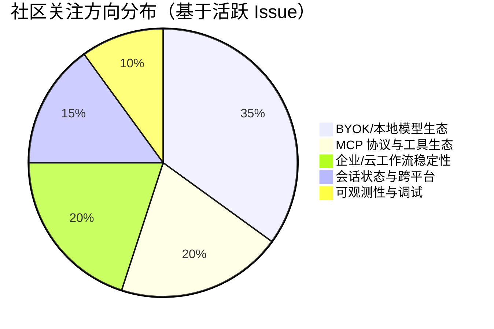

# AI CLI 工具社区动态日报 2026-08-23

> 生成时间: 2026-08-23 03:30 UTC | 覆盖工具: 10 个

- [Claude Code](https://github.com/anthropics/claude-code)
- [OpenAI Codex](https://github.com/openai/codex)
- [Gemini CLI](https://github.com/google-gemini/gemini-cli)
- [GitHub Copilot CLI](https://github.com/github/copilot-cli)
- [Kimi Code CLI](https://github.com/MoonshotAI/kimi-cli)
- [OpenCode](https://github.com/anomalyco/opencode)
- [Pi](https://github.com/badlogic/pi-mono)
- [Qwen Code](https://github.com/QwenLM/qwen-code)
- [DeepSeek TUI](https://github.com/Hmbown/DeepSeek-TUI)
- [Grok Build](https://github.com/xai-org/grok-build)
- [Claude Code Skills](https://github.com/anthropics/skills)

---

## 横向对比

# AI CLI 工具生态横向对比分析报告 | 2026-08-23

---

## 1. 生态全景

当前 AI CLI 工具生态呈现**"功能趋同、体验分化"**的成熟竞争格局：头部产品（Claude Code、Codex、Qwen Code）已进入**稳定性攻坚期**，Windows 平台债务与安全策略调优成为共性技术债务；新兴工具（OpenCode、DeepSeek TUI/CodeWhale）则以**迁移互操作性、外部自动化管控、成本透明化**等差异化能力切入，试图打破现有格局。社区共识正从"模型能力比拼"转向**工程可靠性、跨工具标准化、企业级可观测性**的系统性竞争，AGENTS.md 等配置格式统一提案标志着生态协作意识觉醒。

---

## 2. 各工具活跃度对比

| 工具 | Issues (24h) | PRs (24h) | Release | 关键动态 |
|:---|:---:|:---:|:---|:---|
| **Claude Code** | ~10 条热点 | **0** | v2.1.241 (维护补丁) | 代码冻结迹象；AGENTS.md 提案关闭无官方声明；Windows 连环故障未解 |
| **OpenAI Codex** | ~8 条热点 | **9** (全自动化) | rust-v0.150.0-α.7 / v0.149.0-α.7.2 | 双轨并行迭代；认证脆弱性与远程控制回归成焦点 |
| **Gemini CLI** | 10 条热点 | 10 条 (6 closed, 4 open) | v0.56.0-nightly (无显著变更) | Agent 子系统 P1 级 bug 密集；安全漏洞 GHSA-wpqr-6v78-jr5g 修复中 |
| **GitHub Copilot CLI** | 10 条 (4 条新增 triage) | **0** | 无 | BYOK 多模型切换呼声最高（53👍 占总量 86%）；MCP 容错性争议 |
| **Kimi CLI** | **4 条** (极简) | 2 条 (1 closed) | 无 | 记忆系统成绝对主导议题；非 UTF-8 文件损坏已修复 |
| **OpenCode** | **50 条** | **50 条** | 无 | 代码活跃度全场最高；Question 工具交互体系系统性修复；自动化贡献成熟 |
| **Pi** | ~10 条 (8 closed 快速响应) | 10 条 (8 closed) | 无 | Windows ConPTY 紧急修复；MindsHub 网关接入；loadout 架构前瞻 |
| **Qwen Code** | **47 条** | **50 条** | **v0.22.0 正式版** | 发布节奏稳健；Review 循环收敛、Web Shell OOM、可信 Agent 运行时三线并进 |
| **DeepSeek TUI/CodeWhale** | **18 条** (9 条审计批量产出) | 10 条 | v0.9.11 RC 就绪 | 运营审计驱动精细化；监督运维基础设施四连击；DeepSeek V4 计费紧急适配 |
| **Grok Build** | — | — | 无 | **24h 零活动** |

---

## 3. 共同关注的功能方向

| 功能方向 | 涉及工具 | 具体诉求与数据信号 |
|:---|:---|:---|
| **跨工具标准化** | Claude Code (#6235, 4,961👍)、Gemini CLI (#28968 符号链接兼容 `.gemini`↔`.agents`)、OpenCode | AGENTS.md 兼容成最大公约数；社区拒绝供应商锁定，要求与 Codex/Cursor/Amp 互通配置 |
| **Windows 原生体验** | Claude Code (#81698 GPU 崩溃, #81341 MSIX 签名冲突)、Codex (#39696, #39954, #40163 内存泄漏)、Pi (#7547 39 评论, #8485 ConPTY 修复)、Qwen Code (#9728 复活双平台 CI) | Electron/MSIX 衍生问题 vs 原生 TUI 路径分歧；ConPTY 渲染漂移、Defender IO 惩罚、路径分隔符为共性痛点 |
| **安全策略可调性** | Claude Code (#88416 双重误杀, #88808, #88927 cyber 拦截)、Codex (Guardian 分类器 #40150)、Gemini CLI (#28902 GHSA 漏洞, #26525 确定性脱敏)、Qwen Code (#8102 可信 Agent 运行时, #9556 权限审计) | 从"一刀切 session-halted"向分级模式演进；企业用户要求按项目/仓库白名单豁免 |
| **长会话/上下文可靠性** | Claude Code (#84021 Hook 截断)、Codex (#34724 恢复空白, #29532 SQLite 膨胀)、Gemini CLI (#22323 子 Agent 误报成功, #21409 无限挂死)、Kimi CLI (#1283, #1478 记忆系统)、Qwen Code (#9198 1T 内存 OOM, #9278 Review 失控)、Pi (#6879 压缩延迟, #8464 输出限制延续) | 上下文压缩智能性、会话持久化、记忆系统为共性瓶颈；"搞大项目很痛苦"成跨工具口头禅 |
| **成本透明与优化** | Codex (#33685 周限额消耗异常)、DeepSeek TUI (#5553 MCP Token 归因, #5545 计费紧急修复) | Token 消耗可解释性、低谷价适配、MCP 服务成本归因从"黑盒"转向"可审计" |
| **企业级可观测性** | DeepSeek TUI (#5531 生命周期事件外发箱, #5533 控制套接字)、Codex (#40179 线程树归档, #40068 MCP 运行时状态)、Qwen Code (#9768 Review Coverage 账本) | 无人值守会话的进程管理、事件流标准化、机器可读监控成为 CI/生产部署刚需 |

---

## 4. 差异化定位分析

| 工具 | 功能侧重 | 目标用户 | 技术路线特征 |
|:---|:---|:---|:---|
| **Claude Code** | 情感化交互（Buddy）、深度 IDE 集成、多模态预览 | 个人开发者、创意工作者 | Electron 桌面端为主；Anthropic 模型独占；CLAUDE.md 私有格式 vs AGENTS.md 标准张力 |
| **OpenAI Codex** | 远程控制跨设备同步、结构化任务编排 (`/loop`, `/goal`)、ChatGPT 生态打通 | 移动+桌面协作用户、订阅体系内用户 | Rust CLI + TypeScript SDK 双栈；alpha/beta/stable 三通道；高度自动化发布 |
| **Gemini CLI** | Agent 子系统自治、Google 生态整合、安全沙箱化 | 企业级部署、GCP 用户 | 夜间构建高频；Seatbelt/macOS 沙箱优先；Gemini 3 原生 bash 亲和力 |
| **GitHub Copilot CLI** | BYOK 模型编排、MCP 工具生态、GitHub 工作流原生 | GitHub 生态深度用户、企业许可证用户 | 保守迭代；`COPILOT_MODEL` 单变量限制显生态不成熟；VS Code 行为对齐诉求 |
| **Kimi CLI** | 长文本处理、中文场景优化、记忆系统 | 中文开发者、大文档场景用户 | 功能精简；记忆系统文档黑盒化；非 UTF-8 修复显示工程基础薄弱 |
| **OpenCode** | 非阻塞工作流（Background Bash）、VIM 效率配置、插件生态 | 终端原生开发者、效率工具极客 | TUI/Web/桌面三端统一；自动化贡献 bot 成熟；快速关闭率极高 |
| **Pi** | 终端协议兼容性（Kitty KKP、ConPTY）、扩展 loadout 架构、多网关接入 | 跨平台 TUI 重度用户、自托管爱好者 | Rust 高性能；MindsHub 等推理网关聚合；国际化（中英切换）落地 |
| **Qwen Code** | Review/CI-CD 体系、IDE 深度集成（Companion）、钉钉等企业 IM | 中国企业、阿里生态开发者 | 正式版发布节奏稳健；Aone Code 适配；Web Shell 内存安全；Review 收敛机制 |
| **DeepSeek TUI/CodeWhale** | 监督运维基础设施、成本精细化、迁移互操作性 | 企业级无人值守部署、Claude/Cursor 迁移用户 | 运营审计驱动迭代；per-session 控制套接字创新；北京时间计费适配显本土化深度 |
| **Grok Build** | — | — | **生态边缘化信号**：24h 零活动，与 xAI 战略重心偏离 CLI 工具一致 |

---

## 5. 社区热度与成熟度

### 活跃度梯队

| 梯队 | 工具 | 证据 |
|:---|:---|:---|
| **🔥 超活跃** | OpenCode (50+50)、Qwen Code (47+50) | 日更新量破百；代码冻结期外的最高工程吞吐 |
| **🚀 高活跃** | DeepSeek TUI (18+10, 审计驱动)、Pi (快速关闭率极高)、Codex (PR 全自动化) | 有明确迭代主题或自动化基础设施支撑 |
| **⚠️ 活跃但停滞** | Claude Code (Issue 讨论密集但 0 PR)、Copilot CLI (高票需求无响应) | 社区能量积累但官方工程产出不匹配；存在代码冻结或资源转移可能 |
| **🌙 低活跃** | Gemini CLI (夜间构建例行)、Kimi CLI (Issue 极简) | 功能维护期或社区规模有限 |
| **💀 濒死** | Grok Build | 24h 零活动；需战略层面重启信号 |

### 成熟度判断

| 维度 | 最成熟 | 快速追赶 | 明显短板 |
|:---|:---|:---|:---|
| 发布工程 | Qwen Code (正式版节奏)、Codex (三通道) | OpenCode (高频但无版本号)、Pi (快速合并) | Kimi CLI (无版本发布)、Grok Build (无活动) |
| 社区治理 | OpenCode (自动化 bot)、Pi (自服务合并) | Qwen Code (多平台 CI 修复中) | Claude Code (官方沉默于高票 Issue)、Copilot CLI (triage 积压) |
| 企业就绪 | DeepSeek TUI (监督运维)、Qwen Code (Review 体系) | Codex (远程控制)、Gemini CLI (沙箱) | Claude Code (Windows 危机)、Kimi CLI (记忆黑盒) |
| 跨平台 | Pi (ConPTY/Kitty 专项修复) | OpenCode (Windows 标签补齐) | Claude Code (MSIX 连环故障)、Codex (Windows 多维度赤字) |

---

## 6. 值得关注的趋势信号

| 信号 | 工具来源 | 行业参考价值 |
|:---|:---|:---|
| **AGENTS.md 标准战争** | Claude Code #6235 (4,961👍 关闭无声明) | 配置格式统一将重构工具切换成本；开发者应优先采用 AGENTS.md 而非工具私有格式，保护迁移选择权 |
| **"监督运维"基础设施涌现** | DeepSeek TUI #5531-#5535 (生命周期事件、控制套接字、`/relaunch`) | AI CLI 从"人机交互"向"机机交互"演进；CI/CD、终端复用器、自动化流水线需预留机器可读接口 |
| **Review/CI-CD 闭环失控** | Qwen Code #9278 (增益>1 的修复-引入回路)、#9768 (Coverage 账本) | AI 辅助代码审查的"振荡"现象需工程化收敛机制；单纯依赖上下文压缩或人工 prose 阻尼不足 |
| **成本归因颗粒度竞争** | DeepSeek TUI #5553 (MCP Token 归因)、Codex #33685 (周限额透明度) | MCP 生态扩展伴随隐性成本膨胀；工具选型需评估"每个 MCP 服务器的上下文税" |
| **情感化/陪伴式交互价值被低估** | Claude Code #45596 (Bring Back Buddy, 1,171👍, 268 评论) | CLI 工具差异化可能来自非功能需求；效率工具的"人格化"设计或成用户粘性新维度 |
| **TUI 框架跨平台债务集中爆发** | Pi #8485 (ConPTY)、#7130 (Kitty KKP)；Claude Code #81698 (Electron GPU) | 原生 TUI (Rust) vs Electron 封装路径的优劣在长周期显现；新工具选型应审视终端协议抽象层成熟度 |
| **安全"元级误杀"断裂反馈环** | Claude Code #88416 (申诉行为再被拦截) | 安全策略的递归自指缺陷需架构级修复——用户报告误杀的路径本身不能被安全策略阻断 |

---

> **决策建议**：对于技术决策者，当前是**评估工具锁定风险**的关键窗口——AGENTS.md 兼容性、MCP 生态开放度、BYOK 模型自由度应纳入核心选型指标。对于开发者，**监督运维接口**（生命周期事件、控制套接字）和**成本归因能力**将成为下一代 AI CLI 的差异化门槛，值得提前布局适配。

---

## 各工具详细报告

<details>
<summary><strong>Claude Code</strong> — <a href="https://github.com/anthropics/claude-code">anthropics/claude-code</a></summary>

## Claude Code Skills 社区热点

> 数据来源: [anthropics/skills](https://github.com/anthropics/skills)

# Claude Code Skills 社区热点报告（2026-08-23）

---

## 1. 热门 Skills 排行（按社区关注度）

| 排名 | Skill | 类型 | 状态 | 社区焦点 |
|:---|:---|:---|:---|:---|
| 1 | **skill-creator 修复套件** — `run_eval.py` 0% recall 修复 + Windows 兼容性 | Bugfix | 🟡 Open | [#1298](https://github.com/anthropics/skills/pull/1298) · 核心工具链崩溃，10+ 独立复现，影响所有 Skill 开发者的评估循环 |
| 2 | **document-typography** — AI 生成文档的排版质量控制 | New Skill | 🟡 Open | [#514](https://github.com/anthropics/skills/pull/514) · 解决孤儿词、寡居段落等通用痛点，跨文档类型适用 |
| 3 | **self-audit** — 机械验证 + 四维推理质量门控 | New Skill | 🟡 Open | [#1367](https://github.com/anthropics/skills/pull/1367) · 通用输出审计，damage-severity 优先级排序，v1.3.0 迭代中 |
| 4 | **ServiceNow 平台 Skill** — 覆盖 ITSM/ITOM/SecOps/SPM 等企业模块 | New Skill | 🟡 Open | [#568](https://github.com/anthropics/skills/pull/568) · 企业级广度，8 个月持续更新，平台化而非工具化设计 |
| 5 | **ODT Skill** — OpenDocument 创建/填充/解析/转换 | New Skill | 🟡 Open | [#486](https://github.com/anthropics/skills/pull/486) · 开源文档标准支持，填补 LibreOffice 生态空白 |
| 6 | **pyxel** — 复古游戏开发 MCP 集成 | New Skill | 🟡 Open | [#525](https://github.com/anthropics/skills/pull/525) · 创意开发场景，retro/pixel-art 细分赛道 |
| 7 | **testing-patterns** — 全栈测试方法论（Testing Trophy → E2E） | New Skill | 🟡 Open | [#723](https://github.com/anthropics/skills/pull/723) · 填补测试哲学层指导，而非仅工具使用 |
| 8 | **frontend-design** — 清晰度与可执行性重构 | Improvement | 🟡 Open | [#210](https://github.com/anthropics/skills/pull/210) · 从"文档"转向"可执行指令"，单轮对话内可完成 |

> **注**：PR 评论数均显示 `undefined`，推测为数据抓取限制；实际热度通过关联 Issues 复现数、跨 PR 引用密度及更新频率综合判断。

---

## 2. 社区需求趋势（Issues 提炼）

| 方向 | 代表 Issue | 核心诉求 |
|:---|:---|:---|
| **🔒 安全与信任边界** | [#492](https://github.com/anthropics/skills/issues/492) · 43 评论 | 社区 Skill 冒用 `anthropic/` 命名空间的供应链攻击风险，需官方签名或隔离机制 |
| **🏢 企业协作基础设施** | [#228](https://github.com/anthropics/skills/issues/228) · 16 评论 | Org-wide Skill 共享，替代 Slack 手动传文件的低效模式 |
| **🧠 元认知 / 质量门控** | [#1385](https://github.com/anthropics/skills/issues/1385), [#1329](https://github.com/anthropics/skills/issues/1329) | 预任务校准 → 对抗评审 → 交付验证的三段式管道；compact-memory 符号化状态压缩 |
| **📦 生态互操作** | [#16](https://github.com/anthropics/skills/issues/16), [#29](https://github.com/anthropics/skills/issues/29) | Skills 暴露为 MCP 协议；AWS Bedrock 等非 Claude 运行时兼容 |
| **⚡ 上下文效率** | [#1487](https://github.com/anthropics/skills/issues/1487), [#189](https://github.com/anthropics/skills/issues/189) | 单 Skill 156k token 贪婪注入、插件内容重复等窗口耗尽问题 |
| **📄 文档格式健壮性** | [#12](https://github.com/anthropics/skills/issues/12), [#538](https://github.com/anthropics/skills/pull/538) | OOXML/ODF Whitespace 敏感性、大小写兼容性、书签 ID 冲突等工程细节 |

---

## 3. 高潜力待合并 Skills

| Skill | PR | 关键信号 | 预计落地障碍 |
|:---|:---|:---|:---|
| **skill-creator Windows 修复** | [#1298](https://github.com/anthropics/skills/pull/1298) | 合并 #1099、#1050、#556 多条线索；阻塞所有 Windows 开发者 | 需跨平台回归测试覆盖 |
| **DOCX 书签冲突修复** | [#541](https://github.com/anthropics/skills/pull/541) | 生产环境文档损坏，根因清晰（OOXML shared ID space） | 低，单点修复 |
| **YAML 特殊字符前置校验** | [#539](https://github.com/anthropics/skills/pull/539) | Silent failure 模式，开发者体验痛点 | 低，工具链增强 |
| **UIZZE 反 UI-slop 合作伙伴 Skill** | [#1595](https://github.com/anthropics/skills/pull/1595) | 80万+ 真实屏幕 grounding，外部生态主动接入 | 商务/品牌审核 |
| **Agent Skills 规范合规修复** | [#1538](https://github.com/anthropics/skills/pull/1538) | 官方规范与参考实现自我不一致 | 需 breaking change 评估 |

---

## 4. Skills 生态洞察

> **核心矛盾**：社区正从"功能覆盖"转向"质量可信"——开发者不再满足于 Skill 能做什么，而是要求**可验证的执行确定性**（skill-creator 评估链修复）、**可审计的安全边界**（命名空间隔离、org 共享）、**可控制的资源消耗**（上下文窗口预算）；同时，**元 Skill**（分析自身质量、压缩自身状态、审计自身输出）成为新增长极，标志着生态进入自我反思层。

---

---

# Claude Code 社区动态日报 | 2026-08-23

## 今日速览

今日社区最重磅动态是 **AGENTS.md 标准化提案正式关闭**（#6235），近 5000 赞的呼声推动 Claude Code 向跨工具兼容的上下文配置格式演进；同时 **"Bring Back Buddy" 运动持续发酵**（#45596），268 条评论反映出社区对情感化交互设计的强烈诉求。Windows 平台稳定性问题仍是近期技术债务焦点，GPU 进程崩溃与 MSIX 签名冲突形成连环故障。

---

## 版本发布

| 版本 | 更新内容 |
|:---|:---|
| **v2.1.241** | Bug 修复与可靠性改进 |
| **v2.1.240** | Bug 修复与可靠性改进 |

> 连续两个补丁版本均为维护性更新，无功能变更。结合近期密集的 Windows 崩溃报告，推测团队正集中修复平台稳定性问题。

---

## 社区热点 Issues

### 🔥 标准与生态（2 条）

| # | Issue | 重要性 | 社区反应 |
|:---|:---|:---|:---|
| [#6235](https://github.com/anthropics/claude-code/issues/6235) | **AGENTS.md 支持提案（已关闭）** | ⭐⭐⭐⭐⭐ | 👍 4,961 / 💬 375 |
| | Codex、Amp、Cursor 等竞品已围绕 [agents.md](https://agents.md/) 形成统一标准，而 CLAUDE.md 过于工具特定。提案要求 Claude Code 兼容 AGENTS.md 以实现跨团队协作。**该 Issue 的关闭标志着 Anthropic 可能已在内部采纳或排期此功能**，社区仍在追问具体实现时间表。 | | |
| [#45596](https://github.com/anthropics/claude-code/issues/45596) | **Bring Back Buddy 联合请愿** | ⭐⭐⭐⭐⭐ | 👍 1,171 / 💬 268 |
| | `/buddy` 技能在 v2.1.97 无预警移除，数千开发者失去状态栏陪伴式交互。请愿书以文学化叙事引发共鸣，反映出 CLI 工具情感化设计的商业价值被低估。**标签含 `duplicate` 但独立存活，说明官方尚未给出替代方案**。 | | |

### 🔐 账户与权限（2 条）

| # | Issue | 重要性 | 社区反应 |
|:---|:---|:---|:---|
| [#18435](https://github.com/anthropics/claude-code/issues/18435) | **Claude Desktop 多账户切换** | ⭐⭐⭐⭐☆ | 👍 748 / 💬 168 |
| | 企业用户与个人开发者共用设备时的刚需：支持多 Profile 快速切换。当前需登出/重登，打断工作流。168 条评论中大量提及团队许可证与个人 Pro 账户的冲突场景。 | | |
| [#66504](https://github.com/anthropics/claude-code/issues/66504) | **会话 URL 自动附加到提交信息（已关闭）** | ⭐⭐⭐★☆ | 👍 50 / 💬 16 |
| | 隐私敏感功能默认开启引发反弹——每次 `git commit` 和 PR 描述自动追加 Claude 会话链接。**关闭状态表明已改为 opt-in**，但社区要求更透明的变更通知机制。 | | |

### 🪟 Windows 平台危机（3 条）

| # | Issue | 重要性 | 社区反应 |
|:---|:---|:---|:---|
| [#81698](https://github.com/anthropics/claude-code/issues/81698) | **GPU 进程崩溃导致全应用终止** | ⭐⭐⭐⭐⭐ | 👍 5 / 💬 53 |
| | RTX 5080 + Windows 11 环境下，`exit code 101457950` 使所有运行中会话瞬间丢失。53 条技术评论深入分析内存转储，**问题已定位至 Electron GPU 沙箱与 NVIDIA 驱动交互**。 | | |
| [#81341](https://github.com/anthropics/claude-code/issues/81341) | **MSIX CIG 签名冲突杀死 GPU 进程** | ⭐⭐⭐⭐☆ | 👍 3 / 💬 25 |
| | MicrosoftSignedOnly 代码完整性策略与 vendor-signed `vk_swiftshader.dll` 冲突，每次浏览器预览触发 `0x060C201E`。与 #81698 形成因果链：**此 bug 是 GPU 崩溃的触发器之一**。 | | |
| [#88093](https://github.com/anthropics/claude-code/issues/88093) | **Windows 桌面版窗口置顶无法取消** | ⭐⭐⭐★☆ | 👍 5 / 💬 2 |
| | 窗口始终置顶覆盖其他应用，严重影响多任务工作流。新报告，尚缺技术根因分析。 | | |

### 🤖 模型安全误杀（3 条）

| # | Issue | 重要性 | 社区反应 |
|:---|:---|:---|:---|
| [#88416](https://github.com/anthropics/claude-code/issues/88416) | **reasoning_extraction 误杀后，申诉行为再被 cyber 拦截** | ⭐⭐⭐⭐☆ | 👍 1 / 💬 2 |
| | 元级 bug：正常编码被 `reasoning_extraction` 中断，用户试图记录该事件时又被 `cyber` 标签拦截。**双重误杀暴露安全反馈闭环断裂**，用户无法自助申诉。 | | |
| [#88808](https://github.com/anthropics/claude-code/issues/88808) | **时间线数据渲染触发 cyber 误杀** | ⭐⭐⭐★☆ | 👍 0 / 💬 1 |
| | UI shader 调试被 Opus 4.8 判定为网络安全威胁。含完整 Request ID 便于服务端追踪。 | | |
| [#88927](https://github.com/anthropics/claude-code/issues/88927) | **验证引用文献触发 cyber 误杀** | ⭐⭐⭐★☆ | 👍 0 / 💬 0 |
| | 学术/技术文档审阅场景被安全策略阻断，同日三连发显示 Opus 4.8 的 `general` 域启发式规则过严。 | | |

---

## 重要 PR 进展

> **今日无新增或更新的 Pull Requests**（0 条）

此情况结合连续两个仅含 "Bug fixes" 的补丁版本，暗示团队可能处于：
- 大规模内部重构的代码冻结期
- 私有分支集中处理 Windows 稳定性危机
- 假期或发布周期低谷

---

## 功能需求趋势

基于 50 条活跃 Issue 的聚类分析：

| 趋势方向 | 代表 Issue | 热度指标 |
|:---|:---|:---|
| **跨工具标准化** | #6235 (AGENTS.md) | 🔥🔥🔥🔥🔥 |
| | 社区拒绝供应商锁定，要求配置格式与 Codex/Cursor/Amp 互通 | |
| **情感化/游戏化交互** | #45596 (Buddy) | 🔥🔥🔥🔥🔥 |
| | CLI 工具从纯效率工具向"陪伴式开发环境"演进的需求 | |
| **企业级账户管理** | #18435 (多账户) | 🔥🔥🔥🔥☆ |
| | 团队许可证、个人 Pro、客户账户的三重身份困境 | |
| **Windows 原生体验** | #81698, #81341, #88093, #88913 | 🔥🔥🔥🔥☆ |
| | MSIX 打包、GPU 沙箱、文件监控等 Electron 衍生问题集中爆发 | |
| **安全策略可调性** | #88416, #88808, #88927, #85393 | 🔥🔥🔥☆☆ |
| | 用户要求分级安全模式，而非"一刀切"的 session-halted | |
| **内存/上下文透明性** | #82056, #84021 | 🔥🔥🔥☆☆ |
| | Hook 输出被静默截断、auto-memory 加载状态不可见 | |

---

## 开发者关注点

### 🚨 高频痛点

| 痛点 | 具体表现 | 影响范围 |
|:---|:---|:---|
| **Windows 稳定性连环故障** | GPU 崩溃 → MSIX 重装 → 会话丢失 | Windows 桌面版用户 |
| | #81698 与 #81341 存在因果关系，但分属不同问题单，修复协调难度大 | |
| **安全误杀无申诉通道** | `cyber`/`bio`/`reasoning_extraction` 拦截后，用户无法解释上下文 | 全平台 |
| | #88416 的元级误杀尤为典型：报告 bug 的行为本身被判定为恶意 | |
| **静默数据丢失** | #84021 Hook 输出 >10K 字符丢弃、#85924 移动端队列文本丢失 | 自动化/移动用户 |
| | 无日志、无警告、无回调，破坏"可观测性"原则 | |

### 💡 未满足的核心需求

1. **AGENTS.md 迁移时间表** — #6235 关闭后无官方声明，社区猜测是否已内部分支实现
2. **Buddy 替代方案** — 官方沉默导致 #45596 持续堆积情绪性评论
3. **安全策略白名单** — 企业用户要求按项目/仓库配置豁免规则
4. **Windows 原生安装包** — MSIX 的代码完整性策略与第三方驱动冲突频发，呼吁提供 `.exe` 或便携版

---

> 📌 **订阅提示**：本日报基于 GitHub 公开数据生成。如需追踪特定 Issue 进展，建议启用 GitHub 通知或关注 [anthropics/claude-code](https://github.com/anthropics/claude-code) Releases 页面。

</details>

<details>
<summary><strong>OpenAI Codex</strong> — <a href="https://github.com/openai/codex">openai/codex</a></summary>

# OpenAI Codex 社区动态日报 | 2026-08-23

## 今日速览

今日 Codex 社区活跃度极高，**身份认证与跨平台同步问题**成为焦点——macOS 打开会话触发 ChatGPT 登录失效、Windows 高级账户安全导致 OAuth 刷新令牌失效等问题引发大量讨论。同时，Rust CLI 端连续发布两个 alpha 版本，TUI 渲染和线程元数据管理获得多项底层修复。

---

## 版本发布

| 版本 | 说明 |
|:---|:---|
| **rust-v0.150.0-alpha.7** | Rust CLI 最新 alpha，版本号跃升至 0.150 系列 |
| **rust-v0.149.0-alpha.7.2** | 0.149 系列的补丁更新，与 0.150 并行维护 |

> 两个版本同时发布，表明 0.149 稳定通道与 0.150 新功能线正在并行迭代。

---

## 社区热点 Issues

### 🔴 认证与账户安全（高优先级）

| # | 标题 | 评论 | 👍 | 核心问题 |
|:---|:---|:---:|:---:|:---|
| [#39162](https://github.com/openai/codex/issues/39162) | [macOS] 打开现有会话使 ChatGPT 认证失效并重定向到登录 | 39 | 27 | **回归缺陷**：26.814.41407 版本破坏已有会话的认证状态，影响生产环境工作流 |
| [#39696](https://github.com/openai/codex/issues/39696) | Windows Stable 开启高级账户安全后 OAuth 刷新令牌立即失效；Beta 正常 | 9 | 0 | **安全功能冲突**：Advanced Account Security 与 Stable 通道不兼容，企业用户受阻 |

### 🔴 远程控制与跨设备同步

| # | 标题 | 评论 | 👍 | 核心问题 |
|:---|:---|:---:|:---:|:---|
| [#37403](https://github.com/openai/codex/issues/37403) | macOS 桌面端无法恢复 Remote Control/CLI 线程：`already has an active writer` | 27 | 24 | **严重回归**：8月7日更新后移动端-桌面端协作中断，影响"移动远程+桌面续写"核心场景 |
| [#39954](https://github.com/openai/codex/issues/39954) | Windows + Android Remote Control 成功初始化后进入重连循环 | 10 | 0 | **平台组合缺陷**：Windows 桌面端与 Android 移动端配对完全不可用 |

### 🟡 性能与稳定性

| # | 标题 | 评论 | 👍 | 核心问题 |
|:---|:---|:---:|:---:|:---|
| [#29532](https://github.com/openai/codex/issues/29532) | macOS SQLite TRACE 日志持续写入未完全修复 | 46 | 9 | **长期顽疾**：0.142.0 的部分修复后，`logs_2.sqlite` 仍持续膨胀，磁盘和性能受损 |
| [#33685](https://github.com/openai/codex/issues/33685) | 周度限额消耗速度异常，接近旧版5小时限制 | 28 | 15 | **计费感知问题**：GPT-5.5 High 正常使用下周限额快速耗尽，用户质疑计费模型 |
| [#40163](https://github.com/openai/codex/issues/40163) | Windows ChatGPT/Codex 进程消耗 50+ GB 内存后崩溃 | 3 | 0 | **内存泄漏**：新上报的严重资源失控，可能导致系统级影响 |
| [#40153](https://github.com/openai/codex/issues/40153) | macOS SkyComputerUseService 无限制派生风暴导致系统冻结 | 2 | 0 | **服务级联故障**：Computer Use 功能引发进程风暴，Apple Silicon 设备受影响 |

### 🟡 平台兼容性与工具链

| # | 标题 | 评论 | 👍 | 核心问题 |
|:---|:---|:---:|:---:|:---|
| [#34724](https://github.com/openai/codex/issues/34724) | CLI/TUI 0.145.0 恢复长线程时终端空白无进度 | 7 | 3 | **用户体验**：长会话恢复时的视觉反馈缺失，用户误以为卡死 |
| [#35555](https://github.com/openai/codex/issues/35555) | 日志数据库写锁导致 CLI 启动硬失败，5秒超时无重试 | 6 | 1 | **启动可靠性**：telemetry DB 的锁机制成为单点故障，阻碍 CLI 启动 |

---

## 重要 PR 进展

| # | 标题 | 类型 | 功能/修复内容 |
|:---|:---|:---|:---|
| [#40179](https://github.com/openai/codex/pull/40179) | 归档线程树时关闭已恢复的子代 | 🐛 修复 | 解决协作场景中归档后代线程未正确关闭的泄漏问题 |
| [#40177](https://github.com/openai/codex/pull/40177) | 要求扩展提示片段包含内容类型 | ✨ 功能 | 为 `PromptFragment` 强制添加 `ContentItemKind`，规范技能/记忆/示例的分类 |
| [#40174](https://github.com/openai/codex/pull/40174) | 在消息元数据中保留内容项类型 | ✨ 功能 | 支持 `ContentItemKind` 在消息传递中的透传与往返一致性 |
| [#40169](https://github.com/openai/codex/pull/40169) | 为补丁审批分页添加回归覆盖 | 🧪 测试 | 补全全屏分页器的滚动、调整、接受/取消等交互的测试用例 |
| [#40166](https://github.com/openai/codex/pull/40166) | 显示光标前先移动 TUI 光标 | 🐛 修复 | **修复 Windows 闪烁光标问题**（关联 #39710），消除绘制帧间的光标位置残留 |
| [#40161](https://github.com/openai/codex/pull/40161) | 允许 exec 调用者分类新线程 | ✨ 功能 | 添加 `--thread-source` 全局选项，支持 SDK/CLI 归因线程来源 |
| [#40155](https://github.com/openai/codex/pull/40155) | exec: 在 CLI 和 TypeScript SDK 中暴露线程来源 | ✨ 功能 | 与 #40161 配套，打通 Python SDK 已有的线程来源协议到 TS 端 |
| [#40150](https://github.com/openai/codex/pull/40150) | 使用线程来源元数据用于 Guardian 分类器 | 🔧 重构 | 统一 Guardian 安全分类器的请求标记方式，移除专用字段 |
| [#40068](https://github.com/openai/codex/pull/40068) | 报告运行时 MCP 连接状态 | ✨ 功能 | 为 MCP 服务器状态添加 `runtimeStatus`，区分缓存库存与实际连接 |

> **趋势观察**：今日 9 个 PR 全部来自 `copyberry[bot]` 自动化系统，仅 #40155 有人工作者 `pakrym-oai`，表明 OpenAI 内部正大规模推进自动化代码合并与发布流程。

---

## 功能需求趋势

基于 50 个活跃 Issue 分析，社区关注焦点集中于五大方向：

| 排名 | 方向 | 代表 Issue | 热度指标 |
|:---|:---|:---|:---:|
| 1 | **身份认证与会话安全** | #39162, #39696, #39883 | 评论 51+，👍 27+ |
| 2 | **远程控制与多设备同步** | #37403, #39954 | 评论 37+，👍 24+ |
| 3 | **性能优化与资源管控** | #29532, #33685, #40163, #40153 | 评论 79+，👍 15+ |
| 4 | **Windows 平台一等公民支持** | #39696, #39954, #12962, #34724, #32742 等 | 跨多个子系统 |
| 5 | **TUI/CLI 可靠性** | #34724, #35555, #39970, #40170 | 直接影响开发者日常 |

**新兴趋势**：`/loop` 循环命令（#15679，👍 36）作为自动化工作流需求获得高票支持，与今日 #40170 报告的 `/goal` 循环功能损坏形成呼应——**结构化任务编排**正成为 CLI 高级用户的核心诉求。

---

## 开发者关注点

### 🔥 高频痛点

| 痛点 | 影响范围 | 典型反馈 |
|:---|:---|:---|
| **认证状态脆弱性** | 全平台 | "打开已有会话就掉登录"——会话恢复与认证刷新存在竞态条件 |
| **Windows 稳定性赤字** | Windows 专属 | 内存泄漏、进程树清理失败、TUI 渲染异常、浏览器插件失效等多维度问题 |
| **限额透明度不足** | 计费敏感用户 | 周限额消耗速度缺乏可解释性，用户无法优化使用模式 |
| **长会话恢复体验差** | CLI/TUI 用户 | 空白终端、无进度指示、写锁阻塞——"我以为它死了" |

### 💡 明确需求

1. **可观测性增强**：SQLite 日志写入、内存使用、限额消耗均需暴露指标或提供诊断命令
2. **降级机制**：当 telemetry/日志系统故障时，CLI 应能优雅降级而非硬失败（#35555）
3. **跨平台一致性**：Remote Control 在 macOS/iOS 与 Windows/Android 组合间体验差距显著
4. **安全与便利的平衡**：Advanced Account Security、Guardian 分类器等安全层需减少误杀（#40173）

---

*日报基于 github.com/openai/codex 公开数据生成 | 2026-08-23*

</details>

<details>
<summary><strong>Gemini CLI</strong> — <a href="https://github.com/google-gemini/gemini-cli">google-gemini/gemini-cli</a></summary>

# Gemini CLI 社区动态日报 | 2026-08-23

## 今日速览

今日 Gemini CLI 发布 `v0.56.0-nightly.20260823` 夜间版本，社区持续聚焦**Agent 稳定性**与**安全加固**两大主题。Agent 子系统仍是问题高发区——子 Agent 恢复状态误报、通用 Agent 挂死、浏览器 Agent Wayland 兼容性等 P1 级 Bug 获得密集讨论；同时安全侧修复了变量扩展绕过漏洞（GHSA-wpqr-6v78-jr5g），并推进了 OAuth 回调超时清理等防御性改进。

---

## 版本发布

### [v0.56.0-nightly.20260823.g5411f113c](https://github.com/google-gemini/gemini-cli/releases/tag/v0.56.0-nightly.20260823.g5411f113c)
- **类型**：夜间自动化构建
- **变更**：对比前一日夜间版本无显著功能变更，属常规 CI/CD 流水线产出
- **关联 PR**：[#28969](https://github.com/google-gemini/gemini-cli/pull/28969) 自动化版本提升

---

## 社区热点 Issues（Top 10）

| # | 议题 | 优先级 | 核心问题 | 社区反应 |
|---|------|--------|---------|---------|
| **#22323** | [Subagent 恢复后误报 GOAL 成功](https://github.com/google-gemini/gemini-cli/issues/22323) | P1 | `codebase_investigator` 达到 `MAX_TURNS` 后仍返回 `status: "success"`，掩盖中断事实 | **13 评论**，开发者 matei-anghel 详细复现，维护者标记需重测 |
| **#21409** | [通用 Agent 无限挂死](https://github.com/google-gemini/gemini-cli/issues/21409) | P1 | 任何委托给 generalist agent 的操作（如创建文件夹）永久挂起，禁用子 Agent 可规避 | **8 评论，8 👍**，高频影响基础工作流，用户反馈强烈 |
| **#19873** | [零依赖 OS 沙箱与执行后意图路由](https://github.com/google-gemini/gemini-cli/issues/19873) | P2 | 提议利用 Gemini 3 的原生 bash 亲和力，通过沙箱化 POSIX 工具链提升安全性与 UX | **8 评论**，大型增强提案，涉及架构级安全改造 |
| **#22745** | [AST 感知文件读写评估](https://github.com/google-gemini/gemini-cli/issues/22745) | P2 | 探索基于 AST 的精准代码范围读取，减少误读与 token 浪费 | **7 评论**，EPIC 级调研，关联 #22746 工具选型 |
| **#21968** | [Gemini 不主动使用 Skills 和子 Agent](https://github.com/google-gemini/gemini-cli/issues/21968) | P2 | 模型对自定义 Skill（如 gradle/git）调用率极低，需显式指令才触发 | **6 评论**，反映 Agent 自主决策能力缺陷 |
| **#26522** | [Auto Memory 低信号会话无限重试](https://github.com/google-gemini/gemini-cli/issues/26522) | P2 | 提取 Agent 跳过低价值会话后，该会话仍被反复索引 | **5 评论**，记忆系统质量隐患 |
| **#26525** | [Auto Memory 日志脱敏与缩减](https://github.com/google-gemini/gemini-cli/issues/26525) | P2 | 模型端脱敏不可信，需确定性脱敏；服务侧日志也存在泄露风险 | **4 评论**，安全合规关键问题 |
| **#25166** | [Shell 命令完成后仍显示"等待输入"](https://github.com/google-gemini/gemini-cli/issues/25166) | P1 | 简单命令执行后 UI 状态卡死，阻塞后续交互 | **4 评论，3 👍**，核心执行路径 Bug |
| **#21983** | [浏览器子 Agent Wayland 失败](https://github.com/google-gemini/gemini-cli/issues/21983) | P1 | Linux Wayland 环境下 browser subagent 异常终止 | **4 评论**，Linux 桌面兼容性缺口 |
| **#22186** | [get-shit-done 输出钩子崩溃](https://github.com/google-gemini/gemini-cli/issues/22186) | P1 | 任务总结阶段触发崩溃，影响工作流收尾 | **3 评论**，输出处理管道稳定性问题 |

---

## 重要 PR 进展（Top 10）

| # | PR | 状态 | 功能/修复 | 技术要点 |
|---|-----|------|----------|---------|
| **#28734** | [修复 EACCES 沙箱崩溃](https://github.com/google-gemini/gemini-cli/pull/28734) | ✅ Closed | macOS Seatbelt 沙箱下 `resolveToRealPath` 因权限错误崩溃 | 扩展 `fs.realpathSync` 错误码处理，覆盖 `EACCES` |
| **#28735** | [防止非正 maxChars 导致输出膨胀](https://github.com/google-gemini/gemini-cli/pull/28735) | ✅ Closed | `formatTruncatedToolOutput` 边界条件防护 | 前置守卫阻止 `maxChars <= 0` 时的错误截断行为 |
| **#28736** | [OAuth 回调超时清理](https://github.com/google-gemini/gemini-cli/pull/28736) | ✅ Closed | 认证完成后 dangling timeout 导致资源泄漏 | `resolve/reject` 包装确保 `clearTimeout` + `server.close` |
| **#28828** | [预览模型静默替换警告](https://github.com/google-gemini/gemini-cli/pull/28828) | 🔄 Open | `gemini-3.1-pro-preview` 无权限时自动降级至 `auto-gemini-2.5` 无提示 | 修复 #28825，增加显式警告日志 |
| **#28827** | [避免 401 子串误识别为认证错误](https://github.com/google-gemini/gemini-cli/pull/28827) | 🔄 Open | `isAuthenticationError` 将端口、退出码等含 401 的值误判 | 上下文敏感匹配：要求 `401` 位于消息开头或 HTTP 状态上下文 |
| **#28902** | [阻断 $VAR 变量扩展绕过](https://github.com/google-gemini/gemini-cli/pull/28902) | 🔄 Open | **安全漏洞 GHSA-wpqr-6v78-jr5g**：`detectBashSubstitution` 检测不完整 | 补全 `$VAR`/`${VAR}` 模式检测，加固 CI 工作流 |
| **#28968** | [Skills 目录去重（符号链接/交接点）](https://github.com/google-gemini/gemini-cli/pull/28968) | 🔄 Open | Windows junction + symlink 场景下重复扫描 | 修复 #28944，兼容 `.gemini` ↔ `.agents` 标准迁移 |
| **#28967** | [防止静态刷新清除终端回滚](https://github.com/google-gemini/gemini-cli/pull/28967) | 🔄 Open | `refreshStatic()` 误用 `clearTerminal` 导致 Linux 终端历史丢失 | 修复 #28954，区分 `clearTerminal` 与 `eraseScreen` 语义 |
| **#28823** | [Evals：任务依赖与错误恢复](https://github.com/google-gemini/gemini-cli/pull/28823) | 🔄 Open | 新增行为评估：任务图依赖、可视化、文件 404 重搜、Shell 失败诊断 | XL 级评估基础设施扩展 |
| **#28966** | [修正 excludeTools 文档示例](https://github.com/google-gemini/gemini-cli/pull/28966) | 🔄 Open | 文档示例使用 `run_shell_command(rm -rf *)` 等无效形式 | 明确 exact match 规则，引导至 policy engine 做命令级管控 |

---

## 功能需求趋势

基于 50 条活跃 Issue 分析，社区关注呈现三大收敛方向：

| 方向 | 代表 Issue | 核心诉求 |
|------|-----------|---------|
| **Agent 自主性与可靠性** | #21409, #21968, #22323, #21763 | 子 Agent 调度决策智能化、状态报告准确性、故障透明传递 |
| **安全与隐私工程** | #19873, #26525, #22672, #28902 | 沙箱化执行、确定性脱敏、破坏性操作拦截、漏洞纵深防御 |
| **开发体验精细化** | #22745, #19561, #18836, #21924 | AST 感知减少 token 浪费、持久化任务追踪替代内存型 TODO、终端渲染性能优化 |

**新兴信号**：AST 工具链集成（tilth/glyph 选型）与"零依赖沙箱"提案标志着社区正从"功能可用"向"工程级可信"演进。

---

## 开发者关注点

### 🔴 高频痛点
1. **Agent 挂死与状态误导** — 通用 Agent 无限等待（#21409）、子 Agent 达到轮次上限却报成功（#22323）、Shell 命令状态同步失败（#25166）构成**执行层信任危机**
2. **Linux 桌面兼容性** — Wayland 浏览器支持（#21983）、终端回滚清除（#28967）反映跨平台测试覆盖不足
3. **Skill 发现与调用机制失效** — 自定义 Skill 配置后模型不主动识别（#21968、#28968 符号链接场景），降低扩展系统价值

### 🟡 架构级期待
- **确定性安全 > 模型承诺**：#26525 明确拒绝"让模型自己脱敏"的设计，要求 pipeline 层强制 redaction
- **可观测性缺口**：子 Agent 轨迹需通过 `/chat share` 暴露（#22598），bug 报告缺少子 Agent 上下文（#21763）

### 💡 贡献机会
- `help wanted` 标签 PR 集中在外围修复（A2A 服务器 501 返回、Slash 命令冲突去重、UI 状态保持），适合新贡献者切入

</details>

<details>
<summary><strong>GitHub Copilot CLI</strong> — <a href="https://github.com/github/copilot-cli">github/copilot-cli</a></summary>

# GitHub Copilot CLI 社区动态日报 | 2026-08-23

## 今日速览

今日社区活跃度集中在 **BYOK 多模型切换**与 **MCP 协议兼容性**两大议题，新增 4 个待分类（triage）Issue 暴露 `--cloud` 工作流、Agent 执行可靠性等稳定性问题。无新版本发布，无 PR 更新。

---

## 社区热点 Issues

| # | 议题 | 状态 | 重要性 | 社区反应 |
|---|------|------|--------|----------|
| **#3709** | [会话内多模型切换（含 BYOK/本地模型）](https://github.com/github/copilot-cli/issues/3709) | OPEN | ⭐⭐⭐⭐⭐ | **27 👍**，当前呼声最高的功能需求。用户无法在单一会话中通过 `/model` 切换至本地 BYOK 模型，必须重启 CLI 重设环境变量，严重打断开发流。与 #3282 形成互补诉求。 |
| **#3282** | [支持多 BYOK 模型配置](https://github.com/github/copilot-cli/issues/3282) | OPEN | ⭐⭐⭐⭐⭐ | **26 👍**，9 条讨论。从配置层请求突破单 `COPILOT_MODEL` 环境变量的限制，与 #3709 共同构成 **BYOK 生态成熟度** 的核心瓶颈。 |
| **#2306** | [企业授权策略间歇性失效](https://github.com/github/copilot-cli/issues/2306) | OPEN | ⭐⭐⭐⭐☆ | 周期性复现的权限回归问题，影响企业用户信任。2-3 周触发一次且自愈，指向服务端策略同步或令牌刷新机制的缺陷。 |
| **#4370** | [MCP `server/discover` 返回 -32602 导致初始化失败](https://github.com/github/copilot-cli/issues/4370) | OPEN | ⭐⭐⭐⭐☆ | FastMCP 等主流框架未实现 `server/discover`，Copilot CLI 将其视为致命错误而非可选能力。阻碍 MCP 生态互通，需协议容错性改进。 |
| **#4568** | [`--cloud` 所有者选择器挂起 + 429 限流](https://github.com/github/copilot-cli/issues/4568) | OPEN | ⭐⭐⭐⭐☆ | **今日新增**，无仓库上下文时无限挂起，有上下文时任务轮询触发 429。暴露 `--cloud` 工作流在无状态场景下的设计缺陷。 |
| **#4566** | [Agent 重复确认但不执行工具操作](https://github.com/github/copilot-cli/issues/4566) | OPEN | ⭐⭐⭐⭐☆ | **今日新增**，gpt-5.3-codex 模型下 Agent 循环空转，影响核心交互可靠性。可能关联工具调用解析或执行确认逻辑。 |
| **#4514** | [远程会话本地恢复失败](https://github.com/github/copilot-cli/issues/4514) | OPEN | ⭐⭐⭐☆☆ | 会话可移植性需求，`/resume` 跨环境恢复时路径解析或状态序列化异常，影响多设备工作流。 |
| **#4111** | [Windows 自动更新后旧进程 100% CPU 空转](https://github.com/github/copilot-cli/issues/4111) | OPEN | ⭐⭐⭐☆☆ | 长期运行会话在热更新后执行 `copilot.exe.old`，资源泄漏。Windows 平台特有的更新机制缺陷，生产环境风险。 |
| **#4567** | [允许信任非安全 OTLP 端点](https://github.com/github/copilot-cli/issues/4567) | OPEN | ⭐⭐⭐☆☆ | **今日新增**，对齐 VS Code 行为，本地可观测性场景刚需。当前 `http://` 回环地址被静默禁用，调试体验受损。 |
| **#4565** | [仓库配置扫描告警](https://github.com/github/copilot-cli/issues/4565) | OPEN | ⭐⭐☆☆☆ | **今日新增**，Hubot 自动化检测 `copilot-runtime-bazel-cache` 配置问题，内部基础设施维护信号。 |

---

## 重要 PR 进展

> **今日无 PR 更新**，合并/审查活动停滞。

---

## 功能需求趋势



| 趋势方向 | 代表 Issue | 核心诉求 |
|---------|-----------|---------|
| **BYOK 多模型治理** | #3282, #3709 | 从"能用单个模型"进化为"灵活编排多模型"，要求配置层与会话层双重解放 |
| **MCP 容错互通** | #4370 | CLI 需兼容非完整实现的服务端，区分"必需方法"与"可选能力" |
| **`--cloud` 无状态健壮性** | #4568 | 脱离仓库上下文时的降级策略、轮询退避机制 |
| **Agent 执行可靠性** | #4566 | 工具调用"确认-执行"闭环防空洞，避免 LLM 幻觉消耗用户信任 |
| **热更新零感知** | #4111 | 长会话生命周期管理，进程迁移或优雅终止 |

---

## 开发者关注点

### 🔴 高频痛点

| 痛点 | 场景 | 影响 |
|-----|------|------|
| **BYOK 模型切换成本** | 同一任务需对比 GPT-4o/Claude 3.5/本地模型效果 | 每次切换需 `export COPILOT_MODEL=...` 并重启，实验效率极低 |
| **MCP "伪兼容"陷阱** | 接入 FastMCP 等框架时初始化即崩溃 | 协议文档未标明 `server/discover` 为可选，开发者调试成本转嫁 |
| **企业权限闪烁** | 周一早晨批量出现 "not authorized" | 服务端状态漂移，无客户端自愈能力，需人工重登或等待 |

### 🟡 新兴诉求

- **本地可观测性对齐**：#4567 显示 CLI 与 VS Code 扩展在遥测配置上的行为分裂，多工具链用户期望一致性
- **会话跨设备续接**：#4514 反映远程开发/多机协作场景下状态管理的缺失

### 📊 数据信号

- **triage 标签占比 40%**（4/10）：新 Issue 涌入速度超过社区分类能力，质量管控压力上升
- **👍 集中度**：前两名 Issue 获赞占全部 👍 的 86%（53/62），社区注意力高度聚焦 BYOK 议题

---

> 📌 **分析师备注**：今日无代码合并活动，建议关注团队对 #3709/#3282 的 Roadmap 回应，以及 MCP 协议层容错设计的优先级调整。`--cloud` 与 Agent 相关的新 Issue 若持续涌现，可能指向 1.0.80 版本的回归风险。

</details>

<details>
<summary><strong>Kimi Code CLI</strong> — <a href="https://github.com/MoonshotAI/kimi-cli">MoonshotAI/kimi-cli</a></summary>

# Kimi Code CLI 社区动态日报 | 2026-08-23

> 数据来源：github.com/MoonshotAI/kimi-cli

---

## 1. 今日速览

今日社区无新版本发布，核心焦点仍集中在**记忆系统（Memory System）**这一长期需求上——两条高热度 Issue 在 24 小时内被顶起，显示大项目场景下的上下文持久化仍是用户最大痛点。代码层面，一个修复非 UTF-8 文件损坏的关键 PR 已合并，插件安全文档也在推进中。

---

## 3. 社区热点 Issues

| # | 状态 | 标题 | 核心看点 | 链接 |
|---|:---:|------|---------|------|
| **#1283** | 🔵 OPEN | Memory System - Persistent context across sessions | **社区最热需求**（40 评论）。CatKang 提出完整记忆系统方案：自动记忆（AI 管理）+ 手动记忆（用户自定义），涵盖跨会话上下文、项目模式、用户偏好。讨论深入涉及实现架构，但官方尚未回应路线图。 | [→](https://github.com/MoonshotAI/kimi-cli/issues/1283) |
| **#1478** | 🔵 OPEN | 能否优化记忆层？大项目很痛苦 | **中文用户真实痛点反馈**。hahy36 指出文档缺失记忆相关说明（仅见 agent.md），并引用 OpenClaw 的 SOUL.md/USER.md/MEMORY.md 分层方案作为参考。与 #1283 形成呼应，显示记忆需求已从"功能建议"变为"生产阻塞"。 | [→](https://github.com/MoonshotAI/kimi-cli/issues/1478) |
| **#760** | ⚫ CLOSED | SSL certificate verification fails behind corporate proxy (Zscaler) | 企业环境高频问题。Zscaler 等企业代理导致 SSL 证书验证失败，`/login` 命令无法使用。已关闭但无明确解决方案记录，可能通过环境变量绕过，企业用户仍需关注。 | [→](https://github.com/MoonshotAI/kimi-cli/issues/760) |
| **#2484** | ⚫ CLOSED | . | 空内容 Issue，无实质信息，已清理关闭。 | [→](https://github.com/MoonshotAI/kimi-cli/issues/2484) |

> **说明**：今日仅 4 条 Issue 更新，其中 2 条为记忆系统相关，构成绝对核心议题。

---

## 4. 重要 PR 进展

| # | 状态 | 标题 | 技术价值 | 链接 |
|---|:---:|------|---------|------|
| **#2614** | 🔵 OPEN | docs(plugins): document security and persistent data | **插件生态基础设施**。明确 `~/.kimi/plugins/` 安装路径、`plugin.json` 契约、`inject` 机制的安全边界，为第三方插件开发提供官方依据。无关联 Issue，属主动文档补全。 | [→](https://github.com/MoonshotAI/kimi-cli/pull/2614) |
| **#2594** | ⚫ CLOSED | fix(tools): preserve non-UTF-8 bytes in StrReplaceFile edits | **关键数据完整性修复**。原实现将全文件以 `errors="replace"` 解码，导致编辑区域外的非法 UTF-8 序列被永久替换为 `U+FFFD`（�）。现改为在原始字节流上匹配 `old`/`new` 的 UTF-8 字节子串，避免"无辜字节"损坏。影响二进制文件、遗留编码文件的安全编辑。 | [→](https://github.com/MoonshotAI/kimi-cli/pull/2594) |

---

## 5. 功能需求趋势

基于全部活跃 Issue 提炼，社区关注优先级如下：

```
🔥 记忆系统 / 上下文持久化  ← 绝对主导，#1283 + #1478 双重验证
   └─ 跨会话记忆、项目级知识库、用户偏好学习
   
📋 文档完善
   └─ 记忆功能文档缺失（#1478 明确反馈）、插件安全规范（#2614 推进中）
   
🏢 企业环境适配
   └─ 代理/证书问题（#760）、内网部署、合规审计
   
🔧 工具链可靠性
   └─ 文件编码安全（#2594 已修复）、大文件处理、长会话稳定性
```

**趋势判断**：记忆系统已从"nice-to-have"升级为社区共识的**阻塞性需求**，用户开始自发引用竞品架构（OpenClaw）推动官方响应。建议 MoonshotAI 优先披露路线图，避免用户流失。

---

## 6. 开发者关注点

| 痛点 | 典型反馈 | 紧迫度 |
|------|---------|:------:|
| **大项目上下文丢失** | "搞大项目的时候很痛苦"（#1478） | 🔴 极高 |
| **记忆机制黑盒化** | 文档仅提及 agent.md，无系统说明（#1478） | 🔴 极高 |
| **企业网络兼容性** | Zscaler 代理 SSL 阻断（#760） | 🟡 高 |
| **文件编码安全** | 非 UTF-8 文件静默损坏（#2594 已修复） | 🟢 已解决 |
| **插件安全边界模糊** | 缺乏官方安全与数据持久化说明（#2614 推进中） | 🟡 中 |

---

*日报生成时间：2026-08-23*  
*数据覆盖：过去 24 小时 GitHub 动态*

</details>

<details>
<summary><strong>OpenCode</strong> — <a href="https://github.com/anomalyco/opencode">anomalyco/opencode</a></summary>

# OpenCode 社区动态日报 | 2026-08-23

## 今日速览

今日社区无新 Release，但代码活跃度极高：50 个 Issue 和 50 个 PR 在 24 小时内更新，核心聚焦于 **Question 工具交互体验的系统性修复**（8 个相关 Issue 关闭）、**TUI/Web UI 稳定性改进**以及 **AI 提供商集成优化**。多个由 `opencode-agent[bot]` 贡献的 PR 显示自动化贡献流程已成熟运行。

---

## 社区热点 Issues

| # | 标题 | 状态 | 重要性 | 社区反应 |
|---|------|------|--------|----------|
| [#1970](https://github.com/anomalyco/opencode/issues/1970) | Background Bash Execution（类 Claude Code Ctrl+B） | ✅ CLOSED | **高** | 👍 35，评论 20 |
| | 异步执行长任务不阻塞聊天界面的核心生产力功能，对标 Claude Code 差异化竞争点，社区呼声最高 | | | |
| [#11111](https://github.com/anomalyco/opencode/issues/11111) | VIM 键盘布局支持 | ✅ CLOSED | **高** | 👍 39，评论 13 |
| | 开发者工具的核心效率配置，VIM 模式是终端用户刚需，获赞数全场最高 | | | |
| [#15431](https://github.com/anomalyco/opencode/issues/15431) | macOS 锁屏后会话冻结 | ✅ CLOSED | **中高** | 👍 8，评论 6 |
| | 长时间任务场景下的稳定性痛点，影响开发者日常工作流信任度 | | | |
| [#27302](https://github.com/anomalyco/opencode/issues/27302) | Warp 模式 + 交互问答：输入完全被捕获需强制关闭终端 | ✅ CLOSED | **中高** | 👍 6，评论 6 |
| | 严重 UX 缺陷，用户陷入无法退出的死循环，涉及 TUI 事件路由底层设计 | | | |
| [#22448](https://github.com/anomalyco/opencode/issues/22448) | OpenRouter 502 错误未重试导致子代理/会话中断 | ✅ CLOSED | **中高** | 👍 6，评论 6 |
| | 外部依赖容错机制缺失，直接影响多代理工作流的可靠性 | | | |
| [#32686](https://github.com/anomalyco/opencode/issues/32686) | Plan 模式下被提问时无法切换 Build 模式 | ✅ CLOSED | **中** | 👍 4，评论 5 |
| | 规划-执行双模式交互的设计缺陷，用户决策流程被阻塞 | | | |
| [#31646](https://github.com/anomalyco/opencode/issues/31646) | 代理反复调用不存在的 `unknown` 工具陷入失败循环 | ✅ CLOSED | **中** | 👍 4，评论 4 |
| | LLM 幻觉导致工具调用失控，暴露工具注册与校验机制的漏洞 | | | |
| [#21609](https://github.com/anomalyco/opencode/issues/21609) | 插件无法通过 `@latest` 升级 | ✅ CLOSED | **中** | 👍 5，评论 7 |
| | 插件生态基础设施问题，影响 oh-my-opencode 等核心插件的维护体验 | | | |
| [#31188](https://github.com/anomalyco/opencode/issues/31188) | 含 `thinking` 块的会话首次压缩必失败 | ✅ CLOSED | **中** | 👍 0，评论 4 |
| | Anthropic 扩展思考功能与上下文压缩的兼容性边缘 case | | | |
| [#33540](https://github.com/anomalyco/opencode/issues/33540) | Glob 工具在大目录上无限挂起 | ✅ CLOSED | **中** | 👍 0，评论 3 |
| | 360万+文件场景下的性能灾难，Ripgrep Stream 阻塞问题，附完整根因分析 | | | |

---

## 重要 PR 进展

| # | 标题 | 作者 | 核心内容 |
|---|------|------|----------|
| [#44302](https://github.com/anomalyco/opencode/pull/44302) | fix(app): skip service worker in development | [Hona](https://github.com/Hona) | 开发环境禁用 Service Worker 注册，修复 Vite dev server 404 问题，保持 Playwright 测试稳定性 |
| [#44301](https://github.com/anomalyco/opencode/pull/44301) | fix(client): tolerate slow event connections | [Brendonovich](https://github.com/Brendonovich) | SSE 初始握手超时从 2s 延长至 30s，解决高延迟网络下 `/api/event` 反复取消的连接问题 |
| [#44297](https://github.com/anomalyco/opencode/pull/44297) | fix(tui): label Windows folder session tabs | [opencode-agent[bot]](https://github.com/opencode-agent[bot]) | Windows 驱动器根目录识别 + 非仓库标签回退，补齐跨平台兼容性短板 |
| [#44296](https://github.com/anomalyco/opencode/pull/44296) | fix(app): preserve loopback server host | [Brendonovich](https://github.com/Brendonovich) | 环回地址加载时保持页面 hostname，避免 `127.0.0.1`↔`localhost` 切换导致 Basic Auth 凭据丢失 |
| [#44294](https://github.com/anomalyco/opencode/pull/44294) | fix(app): register service worker after load | [Brendonovich](https://github.com/Brendonovich) | ✅ **已合并** 禁用 PWA 插件阻塞式 HTML 注入，改为 `window.load` 后从应用 bundle 注册，消除 CSP 例外需求 |
| [#44292](https://github.com/anomalyco/opencode/pull/44292) | refactor(opencode): remove legacy 200k pricing | [opencode-agent[bot]](https://github.com/opencode-agent[bot]) | 清理遗留的 `context_over_200k` 定价路径，统一按模型上下文层级定价，简化配置 schema |
| [#44282](https://github.com/anomalyco/opencode/pull/44282) | fix(core): skip models.dev refresh event when unchanged | [thdxr](https://github.com/thdxr) | ✅ **已合并** 5 分钟周期刷新时若目录未变更则跳过 KV 重写与事件广播，消除无意义的多 MB 数据 churn |
| [#44281](https://github.com/anomalyco/opencode/pull/44281) | fix(provider): Anthropic dashed slug through AI Gateway | [superhighfives](https://github.com/superhighfives) | 修复 Cloudflare AI Gateway 下所有 Anthropic 模型 `claude-haiku-4.5` 格式错误，恢复模型可用性 |
| [#44275](https://github.com/anomalyco/opencode/pull/44275) | fix(core): expire locations from session activity | [thdxr](https://github.com/thdxr) | ✅ **已合并** 引入 `LocationActivity` 服务实现 60 分钟空闲淘汰，解决无限 TTL 导致的内存泄漏 |
| [#42873](https://github.com/anomalyco/opencode/pull/42873) | fix(session): reference media parts by message and part id | [xthreehao](https://github.com/xthreehao) | 无视觉能力的模型处理图片附件时，通过 message+part ID 精确定位原始媒体，替代模糊占位符 |

---

## 功能需求趋势

基于 50 条活跃 Issue 分析，社区关注呈现 **三大集中方向**：

| 方向 | 代表 Issue | 热度指标 |
|------|-----------|----------|
| **Question 工具交互体系** | #27302, #28112, #29999, #30028, #30066, #27976/77, #32686, #28712 | 8 个 Issue，覆盖 TUI/Web/桌面三端 |
| 模式切换、焦点管理、回答路由、超时重试、内联输入等全链路体验 | | |
| **IDE/编辑器深度集成** | #11111 (VIM), #33568 (Shortcuts), #28940 (右键菜单) | 👍 41 累计 |
| 专业开发者效率配置，与 VS Code/Cursor 等竞品的功能对齐 | | |
| **异步与长任务执行** | #1970 (Background Bash), #15431 (锁屏恢复), #33540/41 (Glob 超时) | 👍 35 + 8 |
| 从"阻塞式交互"向"非阻塞工作流"演进的基础设施需求 | | |

**新兴趋势**：插件 API 的精细化控制（#24953 按代理过滤工具可见性）、模型提供商生态扩展（OpenRouter session 分组 #40018、Friendli 文档 #39793）。

---

## 开发者关注点

| 痛点类别 | 具体表现 | 涉及 Issue |
|----------|---------|-----------|
| **TUI 事件陷阱** | 问答模态框无法退出、焦点被抢占、输入完全捕获 | #27302, #28112, #29999 |
| **网络容错薄弱** | 外部提供商 502 不重试、SSE 超时过短、慢连接反复断连 | #22448, #44301 |
| **跨平台一致性** | Windows 路径标签、macOS 锁屏行为差异 | #44297, #15431 |
| **LLM 行为失控** | 调用不存在工具、JSON 序列化格式错误、不等待用户回答继续生成 | #31646, #24912, #28712 |
| **性能边界** | 大目录扫描无超时、上下文压缩与 thinking 块冲突 | #33540/41, #31188 |

**核心诉求**：OpenCode 正从"功能可用"向**生产环境鲁棒性**跃迁，开发者对**非阻塞工作流、精细化超时控制、LLM 输出校验**的期望显著高于早期版本。

---

*数据来源：github.com/anomalyco/opencode | 统计周期：2026-08-22 至 2026-08-23*

</details>

<details>
<summary><strong>Pi</strong> — <a href="https://github.com/badlogic/pi-mono">badlogic/pi-mono</a></summary>

# Pi 社区动态日报 | 2026-08-23

## 今日速览

今日社区活跃度极高，**Windows 平台体验修复**成为焦点——ConPTY 自动换行漂移和路径分隔符问题获紧急修复。同时 **MindsHub 推理网关**正式加入内置提供商，**Coding Agent 架构优化**（Node 运行时捆绑、loadout 管理）持续推进，显示团队正着力解决跨平台部署与扩展性瓶颈。

---

## 社区热点 Issues

| # | 状态 | 标题 | 核心看点 | 链接 |
|---|:---:|------|---------|------|
| **#7547** | 🔵 OPEN | Windows 使用方式与问题收集 | **Windows 生态战略议题**，39 条评论为近期最高。社区呼吁明确官方支持的 Windows 路径（WSL/原生/SSH），避免精力分散。petrroll 持续推动，被视为平台体验负责人。 | [链接](https://github.com/earendil-works/pi/issues/7547) |
| **#6879** | 🔵 OPEN | 自动压缩在上下文超 100% 后才触发 | **高赞 bug（18👍）**，GPT-5.6-sol 会话 2 小时未压缩直至 373k token 被 API 拒绝。直接影响长会话可靠性，用户呼吁每轮 agent 后检查。 | [链接](https://github.com/earendil-works/pi/issues/6879) |
| **#7130** | 🔵 OPEN | Kitty 终端 Backspace 重复删除字符 | **终端兼容性顽疾**，Kitty 键盘协议释放事件未过滤。与 #8442 形成问题簇，显示 KKP 实现存在系统性边缘 case。 | [链接](https://github.com/earendil-works/pi/issues/7130) |
| **#8167** | 🔴 CLOSED | llama.cpp 内置支持无法选择模型 | **今日已修复**，llama-server router 模式下模型列表缺失。PR #8479 解决预设暴露问题，SteelPh0enix 验证配置场景。 | [链接](https://github.com/earendil-works/pi/issues/8167) |
| **#8468** | 🔴 CLOSED | GitHub Copilot 登录超时 | **快速响应典型**，prumand 基于未发布 commit 测试遇阻，当日关闭。反映 pre-release 验证流程的摩擦。 | [链接](https://github.com/earendil-works/pi/issues/8468) |
| **#8376** | 🔴 CLOSED | 交互式模型选择持久化作用域可配置 | **UX 精细化**，cmpadden 提出 session/directory/global 三级作用域，当日关闭显示团队已有内部方案或判定 out-of-scope。 | [链接](https://github.com/earendil-works/pi/issues/8376) |
| **#7885** | 🔴 CLOSED | npm 搜索未索引新发布包 | **生态基础设施**，8 月 4 日后新包无法进入 pi.dev/packages 画廊。影响扩展发现，hellokidder 提供完整复现。 | [链接](https://github.com/earendil-works/pi/issues/7885) |
| **#8452** | 🔴 CLOSED | 优化默认压缩提示以保留延续状态 | **AI 核心逻辑**，Ran-Xing 提出编码场景下压缩应区分"直接观测结果"与"推断计划"，而非仅保留可读 prose。涉及 checkpoint 语义设计。 | [链接](https://github.com/earendil-works/pi/issues/8452) |
| **#8442** | 🔴 CLOSED | Kitty 协议下 herdr pane 中 Backspace 失效 | **终端协议层 bug**，与 #7130 互补：legacy `0x7f` 字节在 KKP 激活时未被正确映射。fanyangto 提供精确字节捕获。 | [链接](https://github.com/earendil-works/pi/issues/8442) |
| **#8464** | 🔴 CLOSED | 输出限制延续与中轮压缩 | **自主运行能力**，spinkler 要求模型触及 token 上限时自动继续，而非手动输入。长工具循环场景的关键诉求。 | [链接](https://github.com/earendil-works/pi/issues/8464) |

---

## 重要 PR 进展

| # | 状态 | 标题 | 技术要点 | 链接 |
|---|:---:|------|---------|------|
| **#8500** | 🔴 CLOSED | 修复 plan-mode bash 守卫误报 | **紧急质量修复**：消除 `code` 路径误拦截、demo 文本欺骗提取器两类 false positive。yageabu 当日提交当日合并。 | [链接](https://github.com/earendil-works/pi/pull/8500) |
| **#8474** | 🔴 CLOSED | Coding Agent 捆绑 Node 运行时 | **架构级优化**：mitsuhiko 大幅减少启动文件数，缓解 Windows Defender 扫描导致的 IO 瓶颈。明确标注"需更多测试"。 | [链接](https://github.com/earendil-works/pi/pull/8474) |
| **#8488** | 🔴 CLOSED | 新增 MindsHub 内置提供商 | **生态扩展**：torrmal 自推自合并，单 API key 接入 Claude/GPT/Gemini/Kimi/DeepSeek/Qwen/GLM 全目录。OpenAI/Anthropic 兼容端点。 | [链接](https://github.com/earendil-works/pi/pull/8488) |
| **#8487** | 🔵 OPEN | 暴露 finish reason 兼容性覆盖 | **类型系统补漏**：petrroll 指出 API 已支持但 TS 类型未暴露，修复 #8460。小范围精准修复。 | [链接](https://github.com/earendil-works/pi/pull/8487) |
| **#8486** | 🔴 CLOSED | 编辑器滚动捕获与验证工具 | **测试基础设施**：bonsai 为 #8484 配套的可复现测试框架，含 `editor-scroll-demo.ts` 脚本化 TUI 应用。工程化程度值得借鉴。 | [链接](https://github.com/earendil-works/pi/pull/8486) |
| **#8485** | 🔴 CLOSED | 禁用主屏渲染自动换行修复 ConPTY 漂移 | **Windows 核心修复**：bonsai 解决 ConPTY 在最后一列写入时激进提交换行，导致 `\r\n` 导航错行两格的底层问题。 | [链接](https://github.com/earendil-works/pi/pull/8485) |
| **#8482** | 🔵 OPEN | 修正自定义 footer 文档指向 | **文档修复**：petrroll 将错误文档指向 `ctx.getContextUsage()`，关联 #8392。显示上下文用量 API 近期有变。 | [链接](https://github.com/earendil-works/pi/pull/8482) |
| **#8479** | 🔴 CLOSED | 暴露未加载的 llama.cpp 预设 | **llama.cpp 集成完善**：KaelWD 支持 `--models-preset` 场景下预设可选，llama-swap 兼容。直接解决 #8167。 | [链接](https://github.com/earendil-works/pi/pull/8479) |
| **#7148** | 🔵 OPEN | 实验性 loadout 管理 | **扩展架构前瞻**：mitsuhiko 草案允许会话中 `/loadout` 动态启停扩展，状态持久化至会话恢复。标注"非最终设计，需用户确认"。 | [链接](https://github.com/earendil-works/pi/pull/7148) |
| **#8295** | 🔴 CLOSED | `/settings` 语言切换 | **国际化落地**：Dazzle-sys 实现中英双语切换，含 `supported-locales.ts` 运行时验证。为更多 locale 预留扩展点。 | [链接](https://github.com/earendil-works/pi/pull/8295) |

---

## 功能需求趋势

基于 50 条活跃 Issue 分析，社区关注呈 **五大聚类**：

| 方向 | 热度 | 典型表现 |
|------|:---:|---------|
| **🪟 Windows 原生体验** | 🔥🔥🔥 | #7547（39 评论）、#8484/#8485（ConPTY）、#8441（路径分隔符）、#8372（键位冲突）。平台差异处理已成技术债务集中区。 |
| **🧠 上下文/压缩智能** | 🔥🔥🔥 | #6879（压缩延迟）、#8452（压缩语义）、#8464（输出限制延续）、#8498（保留尾轮超限）。长会话可靠性是 AI 产品核心指标。 |
| **🔌 模型提供商生态** | 🔥🔥🔥 | #8488/#8489（MindsHub）、#8469/#8438（DeepSeek vision）、#8454（OpenRouter reasoning）、#8450（Parasail）。多网关兼容成标配需求。 |
| **🖥️ 终端协议兼容性** | 🔥🔥 | #7130/#8442（Kitty KKP）、#8434（TUI 无响应）、#8484（ConPTY）。现代终端特性支持是 TUI 框架长期挑战。 |
| **🔧 扩展/配置精细化** | 🔥🔥 | #8376（模型选择作用域）、#8431（排除扩展）、#8448（块展开配置）、#8385（SQLite 记忆层）。用户要求从"能用"到"按需定制"。 |

---

## 开发者关注点

### 🔴 高频痛点

| 问题 | 影响面 | 社区声音 |
|------|--------|---------|
| **Windows 二等公民体验** | 用户基数扩张瓶颈 | "gazzilion developers on windows"（#7547）；Defender IO 惩罚、ConPTY 渲染漂移、路径分隔符三重打击 |
| **长会话上下文失控** | 生产力场景核心障碍 | 2 小时会话 373k token 才触发压缩（#6879）；工具循环中无中轮检查（#8464） |
| **终端兼容性矩阵爆炸** | 维护成本激增 | Kitty KKP、ConPTY、VS Code 终端、herdr pane 各自有独立 bug，缺乏统一抽象层 |

### 🟡 新兴需求

- **推理模型强制兼容**：OpenRouter `stealth/ox-alpha` 等 reasoning-mandatory 端点要求显式处理 `reasoning` 字段（#8454）
- **远程会话本地 TUI**：Kubernetes devbox 场景要求 RemoteSession 保留服务端能力，TUI 跑在客户端（#8481）
- **扩展生命周期可观测**：`before_provider_request`/`after_provider_response` 缺乏共享 request ID，状态管理困难（#8380）

### 💡 团队响应特征

- **快速关闭率极高**：24 小时内 20+ Issue/PR 关闭，显示维护团队节奏激进
- **自服务合并趋势**：torrmal（MindsHub 作者）直接提交 PR #8488 并合并，社区贡献通道畅通
- **测试投资加大**：#8486 的 scriptable TUI 测试工具标志质量工程升级

---

> 📌 **跟踪建议**：关注 #7547 Windows 战略结论、#6879 压缩机制重构、#7148 loadout 架构最终设计——三者将定义 Pi 下季度的平台边界与扩展模型。

</details>

<details>
<summary><strong>Qwen Code</strong> — <a href="https://github.com/QwenLM/qwen-code">QwenLM/qwen-code</a></summary>

# Qwen Code 社区动态日报 | 2026-08-23

---

## 1. 今日速览

**v0.22.0 正式版与夜间构建同步发布**，Web Shell 内存安全与 Review 循环稳定性成为核心改进方向。社区今日活跃度极高，47 个 Issues 与 50 个 PR 在 24 小时内更新，IDE 集成、可信 Agent 运行时、Review 收敛机制成为讨论焦点。

---

## 2. 版本发布

### [v0.22.0](https://github.com/QwenLM/qwen-code/releases/tag/v0.22.0) 正式版

**核心亮点：**
- **Web Shell 防 OOM 崩溃**：通过限制 transcript 保留上限与裁剪超大 replay，解决长会话内存溢出问题 ([#9303](https://github.com/QwenLM/qwen-code/pull/9303))
- **Review 循环可解释性**：当审查进入不稳定状态时，系统会标注具体文件及其反复出现的 findings，帮助诊断"修复-引入新缺陷"的失控回路

### [v0.22.0-nightly.20260823.1007bcacfc](https://github.com/QwenLM/qwen-code/releases/tag/v0.22.0-nightly.20260823.1007bcacfc)

- 修复 Web Shell 从概览面板打开时 session workspace cwd 传递问题 ([#9730](https://github.com/QwenLM/qwen-code/pull/9730))

---

## 3. 社区热点 Issues

| # | Issue | 重要性 | 社区反应 |
|---|-------|--------|---------|
| [#8102](https://github.com/QwenLM/qwen-code/issues/8102) | **可信 Agent 运行时：确定性工具执行边界** | 🔴 架构级提案 | 17 条评论，P3 但长期关注。提出"将 LLM 置于信任边界之外"的增量安全方向，涉及核心安全架构 |
| [#9278](https://github.com/QwenLM/qwen-code/issues/9278) | **/review 发布时收敛建议设计** | 🔴 解决 Review 失控回路 | 9 条评论，wenshao 主导。系统性记录"push→评审→修复→diff 膨胀→更多 finding"的增益大于 1 的回路问题 |
| [#9556](https://github.com/QwenLM/qwen-code/issues/9556) | **Review 管道代码执行权限审计** | 🟡 安全合规 | 8 条评论。质疑 review 流程以调用者身份执行代码的权限授予是否合理 |
| [#9198](https://github.com/QwenLM/qwen-code/issues/9198) | **长会话 OOM（1T 内存服务器）** | 🟡 稳定性顽疾 | 5 条评论。运行一周未退出即 OOM，且导致 tmux 终端乱码，竞品无此问题 |
| [#9733](https://github.com/QwenLM/qwen-code/issues/9733) | **循环检测误杀合法验证周期** | 🟡 自动化阻断 | 4 条评论。多阶段自动化运行中，write→run→edit→re-run 的合法序列被误判为死循环，且无法无人值守恢复 |
| [#9706](https://github.com/QwenLM/qwen-code/issues/9706) | **会话标题生成复制系统提示示例** | 🟢 体验瑕疵 | 4 条评论，已关闭。标题生成器逐字输出提示中的示例"Fix login button on mobile" |
| [#9573](https://github.com/QwenLM/qwen-code/issues/9573) | **恢复会话工具结果丢失** | 🟢 数据一致性 | 4 条评论，已关闭。正常完成的工具调用在会话恢复后显示"Tool result missing from saved history" |
| [#9757](https://github.com/QwenLM/qwen-code/issues/9757) | **OpenRouter 下 Auto Mode 分类器不可用** | 🟢 生态兼容 | 3 条评论。Stage 1 分类器失效导致回退手动审批，影响 OpenRouter 用户体验 |
| [#9752](https://github.com/QwenLM/qwen-code/issues/9752) | **ACP 消息重写因目录路径崩溃** | 🟢 边界情况 | 3 条评论。`promptFile` 指向目录时 `EISDIR` 未捕获，直接阻断会话启动 |
| [#9333](https://github.com/QwenLM/qwen-code/issues/9333) | **会话级持久化 Node REPL（MCP Server 形态）** | 🟢 路线图关键 | 3 条评论。**交付形态重大变更**：从内置 core 工具改为独立 MCP server，需维护者决策 |

---

## 4. 重要 PR 进展

| # | PR | 功能/修复内容 | 状态 |
|---|-----|------------|------|
| [#9768](https://github.com/QwenLM/qwen-code/pull/9768) | **Review Coverage 密封分类账本** | 将 chunk coverage 转为带身份、原因说明、独立读取度量的账本，提升 review 可审计性 | 🆕 新建 |
| [#9769](https://github.com/QwenLM/qwen-code/pull/9769) | **Web Shell 脏工作树解锁 git update** | "Update Project" 遇未提交变更时，从错误死局转为提供"stash & pull"或"commit & pull"选项面板 | 🆕 新建 |
| [#9764](https://github.com/QwenLM/qwen-code/pull/9764) | **分支会话继承源标题** | 解决 UUID 片段命名问题，规范 `(Branch)` 后缀，分配最低可用 `Title(N)` | 🆕 新建 |
| [#9741](https://github.com/QwenLM/qwen-code/pull/9741) | **内容过滤器前置拦截（residue probe）** | 在 scratch-tree 还原前检测本地 git content filter，防止 `filter.<name>.smudge` 执行 | 更新 |
| [#9737](https://github.com/QwenLM/qwen-code/pull/9737) | **CLI utils 叶子层依赖方向强制** | 机械性边界治理，使 `packages/cli/src/utils/` 成为真叶子层，阻断循环依赖 | 更新 |
| [#9728](https://github.com/QwenLM/qwen-code/pull/9728) | **修复 Windows/macOS CI 测试失败** | 产品修复 + 测试夹具修复 + CI 工具修复，为复活双平台 CI 车道做准备 | 更新 |
| [#9627](https://github.com/QwenLM/qwen-code/pull/9627) | **Aone Code 评论状态与预提交支持** | 补全 Aone Code MR 评审的评论线程索引、resolved/outdated 状态、blocker 信号 | 更新 |
| [#9526](https://github.com/QwenLM/qwen-code/pull/9526) | **持久性 Critical 收敛建议** | 当 telemetry 证明 review 循环卡在 Critical 上时，发出"带残余风险着陆"建议 | 更新 |
| [#9394](https://github.com/QwenLM/qwen-code/pull/9394) | **钉钉 Workspace 频道内置支持** | 支持 DM、@提及、环境群组、文档提及通知、待办变更、源范围会话 | 更新 |
| [#8583](https://github.com/QwenLM/qwen-code/pull/8583) | **实验性会话工作流驾驶舱** | 跨计划捕获、修订绑定审批、transcript 投影、Agent 执行、WebShell 的完整工作流路径 | 更新 |

---

## 5. 功能需求趋势

```
┌─────────────────────────────────────────┐
│  🔥 IDE 集成（VS Code Companion）        │
│     WebShell transcript 嵌入、拖拽文件、  │
│     CSP 策略、稳定 block identity        │
│     ─────────────────────────────────   │
│  🔥 Review / CI-CD 体系健壮性            │
│     收敛诊断、权限审计、Aone 适配、       │
│     覆盖率账本、渲染证据捕获              │
│     ─────────────────────────────────   │
│  ⚡ 可信 Agent 运行时（安全架构）          │
│     确定性边界、LLM 外置信任边界、        │
│     工具执行授权与观测                    │
│     ─────────────────────────────────   │
│  ⚡ 会话生命周期治理                      │
│     持久化恢复、分支命名、模型记忆、      │
│     HITL 状态保持、sessionRotation       │
│     ─────────────────────────────────   │
│  📌 Node 生态深度集成                     │
│     MCP Server 形态 REPL、Computer Use   │
│     SDK 技能化调用                        │
└─────────────────────────────────────────┘
```

---

## 6. 开发者关注点

| 痛点/需求 | 典型反馈 | 涉及 Issue |
|----------|---------|-----------|
| **长会话稳定性** | "跑了一周多，1T 内存服务器 OOM，tmux 乱码无法操作" | [#9198](https://github.com/QwenLM/qwen-code/issues/9198) |
| **Review 循环失控** | "5 轮后只处理 Critical 这句 prose 是唯一阻尼器，恰在上下文最满时" | [#9278](https://github.com/QwenLM/qwen-code/issues/9278) |
| **自动化误阻断** | "合法验证周期被循环检测杀死，无法无人值守恢复" | [#9733](https://github.com/QwenLM/qwen-code/issues/9733) |
| **跨平台 CI 可靠性** | Windows/macOS 测试车道长期失败，阻碍发布信心 | [#9728](https://github.com/QwenLM/qwen-code/pull/9728) |
| **SDK/CLI 行为不一致** | Python SDK 拒绝 `permission_mode="auto"`，CLI 却支持 | [#9002](https://github.com/QwenLM/qwen-code/issues/9002) |
| **IDE 体验落差** | "Copilot Chat 能拖拽文件，Qwen Code Companion 不支持" | [#9743](https://github.com/QwenLM/qwen-code/issues/9743) |

---

*日报基于 GitHub 公开数据生成，时间范围：2026-08-22 至 2026-08-23*

</details>

<details>
<summary><strong>DeepSeek TUI</strong> — <a href="https://github.com/Hmbown/DeepSeek-TUI">Hmbown/DeepSeek-TUI</a></summary>

# DeepSeek TUI（CodeWhale）社区动态日报 | 2026-08-23

---

## 今日速览

今日社区活跃度极高，**Hmbown 一次性抛出 9 个 v0.9.11 运营审计衍生的功能需求**，覆盖终端体验、上下文成本可视化、导入迁移等场景；同时 **M-Maciej 的监督运维四连击（生命周期事件、/relaunch、控制套接字、目标延续节奏修复）** 形成完整的外部自动化管控方案。PR 侧，v0.9.11 发布准备完成，DeepSeek V4 计费规则紧急适配周末全时段低谷价。

---

## 版本发布

无新 Release。v0.9.11 发布候选已准备就绪（[#5542](https://github.com/Hmbown/CodeWhale/pull/5542)），预计近期正式推送。

---

## 社区热点 Issues（10 条）

| # | Issue | 重要性 | 社区动态 |
|---|-------|--------|---------|
| [#5535](https://github.com/Hmbown/CodeWhale/pull/5535) | **Supervised operation stack: lifecycle outbox, /relaunch, per-session control socket, and the goal-continuation quiet-period fix** | 🔥 **核心基础设施** | M-Maciej 将 4 个紧密关联的 Issue（#5531-#5534）打包为统一 PR，解决长期无人值守会话的机器可读监控、热更新、进程控制三大痛点，是企业级部署的关键拼图 |
| [#5533](https://github.com/Hmbown/CodeWhale/issues/5533) | Feature: the control surface for supervised operation | 🔥 外部管控刚需 | 提出 per-session 控制套接字（消息/中断/重启/状态），配合 #5535 实现，解决终端复用器、CI 流水线等场景下的进程管理难题 |
| [#5532](https://github.com/Hmbown/CodeWhale/issues/5532) | Feature: /relaunch — switch a running session to the current binary | 🔥 热更新闭环 | 补齐 `/update` 后必须手动重启的断点，实现 TUI 场景下的自替换重启，与 #5533 控制套接字协同 |
| [#5531](https://github.com/Hmbown/CodeWhale/issues/5531) | Feature: local lifecycle event outbox (JSONL + webhook) with turn_stalled / turn_failed events | 🔥 可观测性基石 | 为外部监督者提供标准化的生命周期事件流，包含关键的 `turn_stalled` 和 `turn_failed` 告警事件 |
| [#5557](https://github.com/Hmbown/CodeWhale/issues/5557) | /import-claude: migrate ~/.claude permissions, env vars, MCP servers, hooks, and paths | ⭐ 迁移体验 | v0.9.11 运营审计产出，降低 Claude Code 用户切换成本，显式可审查的迁移流程优于隐式发现 |
| [#5556](https://github.com/Hmbown/CodeWhale/issues/5556) | Onboarding: opt-in /tutorial (/tour) pager | ⭐ 新用户留存 | 针对 Claude/Cursor/Codex 迁移用户的概念映射教程，解决"功能都有但找不到"的入门痛点 |
| [#5553](https://github.com/Hmbown/CodeWhale/issues/5553) | /context: attribute token cost to tool definitions and each MCP server announcement | ⭐ 成本透明 | 上下文检查器新增 MCP 服务器和工具定义的 Token 成本归因，帮助用户决策裁剪哪些 MCP 服务 |
| [#5550](https://github.com/Hmbown/CodeWhale/issues/5550) | @path:START-END line-range mentions and a hidden-file prefix in the file picker | ⭐ 精确上下文 | 支持行范围提及（如 `@src/lib.rs:120-160`）和点文件显式切换，减少无关 Token 消耗 |
| [#5546](https://github.com/Hmbown/CodeWhale/issues/5546) | [bug] [redacted] output from tools impairs editing | ⚠️ 用户体验 | 升级 HEAD 后工具输出出现"redacted"标记干扰编辑，ronohara 提供详细会话记录，需紧急关注 |
| [#5534](https://github.com/Hmbown/CodeWhale/issues/5534) | [bug] Goal-continuation cadence is bypassed on the within-turn dispatch path | ⚠️ 可靠性 | #5508 引入的可取消目标延续节奏在恢复/CLI 会话中被绕过，导致 passes 瞬间触发，M-Maciej 已定位修复 |

---

## 重要 PR 进展（10 条）

| # | PR | 状态 | 内容摘要 |
|---|-----|------|---------|
| [#5545](https://github.com/Hmbown/CodeWhale/pull/5545) | fix(pricing): bill whole Beijing weekends off-peak for DeepSeek V4 | 🟢 Open | **紧急计费修复**：DeepSeek 自 8/23 起调整计费规则，周末全天低谷价；原 UTC 小时判断逻辑失效，改为北京时间周末全时段判定 |
| [#5544](https://github.com/Hmbown/CodeWhale/pull/5544) | feat(web): move docs/subagents and docs/mcp onto the dictionary spine | 🟢 Open | #5337 本地化系列续作，消除 34 个 `isZh` 分支，推进中英文文档架构统一 |
| [#5535](https://github.com/Hmbown/CodeWhale/pull/5535) | Supervised operation stack | 🟢 Open | **四合一基础设施 PR**：生命周期事件外发箱、`/relaunch`、per-session 控制套接字、目标延续静默期修复 |
| [#5406](https://github.com/Hmbown/CodeWhale/pull/5406) | feat(tui): prefab provider templates and test-connection | 🔴 Closed | 预设第三方提供商模板（OpenCode Zen/Go、Agnes、SenseNova），用户仅需填 API key；测试连接功能验证连通性 |
| [#5530](https://github.com/Hmbown/CodeWhale/pull/5530) | fix(cli): route legacy completions through public binary | 🔴 Closed | 修复 `codewhale completions` 遗留命令转发路径，统一使用公共二进制生成补全脚本 |
| [#5542](https://github.com/Hmbown/CodeWhale/pull/5542) | release: prepare Codewhale v0.9.11 | 🔴 Closed | v0.9.11 发布候选准备完成，排除 benchmarks 目录，字节级验证与本地 gated 构建一致 |
| [#5523](https://github.com/Hmbown/CodeWhale/pull/5523) | refactor(tui): extract tool call stages from turn loop | 🔴 Closed | 工具调用阶段重构：`plan_tool_calls` → `execute_planned_tools` → `process_tool_results`，保持原有控制顺序和取消行为 |
| [#5524](https://github.com/Hmbown/CodeWhale/pull/5524) | feat(tui): add multi-file read_lints operation | 🟢 Open | LSP 工具新增 `read_lints` 多文件操作，复用会话 `LspManager` 避免重复启停语言服务器 |
| [#5525](https://github.com/Hmbown/CodeWhale/pull/5525) | refactor(tui): adopt command shapes in utility group (FEAT-018) | 🟢 Open | 工具命令组全面采用 FEAT-014 引入的外部命令形态，七条命令执行边界改造，为后续 crate 分解铺路 |
| [#1701](https://github.com/Hmbown/CodeWhale/pull/1701) | chore(deps): bump portable-pty to 0.9.0 | 🔴 Closed | 升级 `portable-pty` 至 0.9.0，新增 loongarch64 支持，消除 `nix 0.25.1` 重复依赖 |

---

## 功能需求趋势

从今日 18 条 Issue 提炼出五大方向：

| 趋势方向 | 代表 Issue | 说明 |
|---------|-----------|------|
| **🤖 外部监督与自动化运维** | #5531-#5534, #5535 | 最强信号：无人值守会话的进程管理、事件外发、热更新、控制接口，企业/CI 场景刚需 |
| **🔄 迁移与互操作性** | #5557, #5556 | 降低 Claude/Cursor/Codex 用户切换成本，配置导入 + 概念映射双管齐下 |
| **💰 成本可观测与优化** | #5553, #5550 | Token 成本归因细化到 MCP 服务器和工具定义，行范围提及减少无效上下文 |
| **🎨 终端体验精细化** | #5554, #5551, #5555 | OSC 光标强调色、块级操作快捷键、剪贴板失败降级，TUI 体验向 GUI 看齐 |
| **🔧 自诊断与自愈** | #5552, #5549 | `doctor --fix` 自动修复、shell 工具多任务等待/命名杀，运维效率提升 |

---

## 开发者关注点

### 高频痛点
1. **"Redacted" 污染输出流**（#5546）：升级最新源码后工具输出出现 `[redacted]` 标记，严重干扰编辑流程，疑似安全审查机制过度触发
2. **TUI 持有终端时的自重启难题**（#5532）：`/update` 后必须手动重启，TUI 进程自替换在终端环境下的技术复杂度被低估

### 架构级诉求
3. **Crate 分解长期跟踪**（#5316）：EPIC-005 作为 umbrella issue 持续跟踪 CodeWhale TUI 的 crate 拆分，FEAT-018（#5525）等 PR 正在逐步落地执行边界改造
4. **CI 覆盖率缺口**（#5547）：非 `work/v*`/`fix/*`/`rebrand/*`/`main` 分支的 PR 缺失 Linux 测试，导致 `codex/*` 等集成分支质量盲区

### 运营审计驱动
5. **v0.9.11 ops potential audit 批量产出**：Hmbown 今日集中创建 9 个 Issue（#5547-#5557），全部标注 `_Source: v0.9.11 ops potential audit`，显示项目已进入规模化运营优化阶段，从"功能有无"转向"体验精细度"竞争。

---

*日报基于 github.com/Hmbown/CodeWhale 公开数据生成*

</details>

<details>
<summary><strong>Grok Build</strong> — <a href="https://github.com/xai-org/grok-build">xai-org/grok-build</a></summary>

过去24小时无活动。

</details>

---
*本日报由 [agents-radar](https://github.com/brysoh435-dev/agents-radar) 自动生成。*